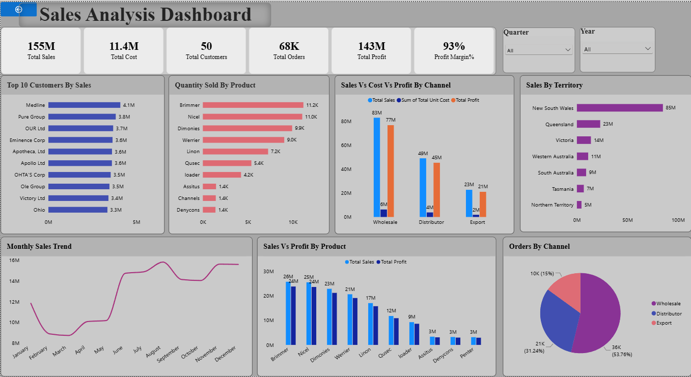

# sales-analysis-dashboard

## Power BI Sales Analysis & Business Insights

A personal data analytics project focused on analyzing sales performance and identifying business insights using Microsoft Power BI.

## Project Overview

This project analyzes sales data to understand sales and profit performance across customers, products, sales channels, and territories.
The project focuses on creating an interactive Power BI dashboard using the provided cleaned dataset to visualize key business metrics, compare performance, and identify meaningful patterns.

## Project Objectives

The main objectives of this project are:

- To analyze overall sales and profit performance.
- To compare sales performance across different channels and territories.
- To identify top-performing customers and products.
- To explore monthly sales trends.
- To present key business metrics through interactive visualizations.
- To derive meaningful business insights from dashboard analysis.

## Tools & Technologies

- Microsoft Power BI
- Data visualization
- KPI cards and business metrics
- Interactive dashboards
- Filters and slicers
- Data modeling
- Business performance reporting

## Project Workflow

### 1. Dataset Exploration

Reviewed the cleaned dataset provided for the project to understand its structure, available tables, and relevant business attributes.

### 2. Dashboard Development

Created visualizations to present sales, cost, profit, customer, order, product, channel, and territory information.

### 3. Interactive Analysis

Added interactive filters and slicers to explore sales performance across different quarters and years.

### 4. Business Analysis

Analyzed dashboard visualizations to compare customer contributions, product performance, sales channels, territories, and monthly sales trends.

### 5. Insights & Interpretation

Used the dashboard to identify performance patterns and support data-driven business understanding.

## Key Analysis Areas

- Overall sales and profit performance
- Total cost and profit margin
- Top 10 customers by sales
- Quantity sold by product
- Sales, cost, and profit by channel
- Sales by territory
- Monthly sales trends
- Orders by channel
- Product-wise sales and profit comparison

## Key Business Insights

The dashboard provides an overview of sales and profitability across multiple business dimensions.
Customer and product visualizations help compare sales contributions and product demand. Channel and territory analysis allows users to explore differences in business performance, while monthly sales trends help identify changes over time.

## Power BI Dashboard

The interactive Power BI dashboard presents key business metrics and visualizations in a consolidated view.

## Results & Conclusion

This project demonstrates practical skills in Power BI dashboard development, data visualization, interactive reporting, and business insight generation. The dashboard makes it easier to explore sales performance across customers, products, channels, and territories.

## Future Improvements

- Add more detailed profitability analysis.
- Enhance dashboard navigation and interactivity.
- Develop additional visualizations for business comparisons.
- Expand business recommendations based on analytical findings.

## Author

Shilpi Pandit

Personal Data Analytics Project
